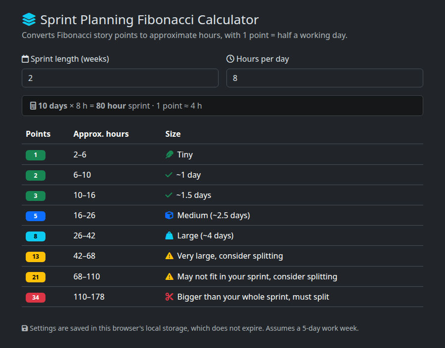

# SprintPlan — Sprint Planning Fibonacci Calculator


A single-page calculator that converts Fibonacci story points into approximate hours and sizing guidance for a sprint. Teams enter their sprint length and daily hours to see how big each point value really is.



---

## Features

- **Live calculation** – Changing the sprint length (weeks) or hours per day updates the table immediately.
- **Points-to-hours table** – Shows each Fibonacci point value with its approximate hours range (min–max) and a size label (Tiny, ~N days, Medium, Large, Very large, Bigger than your whole sprint).
- **Sprint-relative sizing** – Size labels are based on the share of the sprint a story takes up, so they stay meaningful for any sprint length.
- **Auto-extending scale** – Always shows 1–21 points, and adds more Fibonacci values until one exceeds the whole sprint.
- **Saved settings** – Inputs are stored in the browser's `localStorage`, which does not expire.
- **Sensible defaults** – A 2-week sprint at 8 hours per day.

---

## Tech Stack

- Language: HTML, vanilla JavaScript
- Frontend: Bootstrap 5.3.3 (dark theme) and Font Awesome 6.5.2, both loaded from CDNs
- Storage: Browser `localStorage`
- Build: Terser 5.31.6 minifies `app.js` during the Docker build (`node:22-alpine` build stage)
- Hosting: Static files, or a Docker image built on `busybox:1.36-musl` that serves the page with BusyBox `httpd` (about 2.5 MB)

---

## Quick Start

### Prerequisites

- A modern web browser
- Docker (optional, for the container)

### Installations

**Get the project**

Copy or clone the project folder. There are no dependencies to install.

**Development**

Open `index.html` directly in a browser:
```bash
xdg-open index.html
```
**Production Build**
```bash
docker build -t sprintplan .
docker run -d --rm -p 8080:8080 --name sprintplan sprintplan
```
Visit: http://localhost:8080

## Repository Structure
```bash
SprintPlan/
├── index.html      # The calculator page: markup and styles
├── app.js          # Calculation, table rendering and saved settings
├── Dockerfile      # Minifies app.js, then serves the page with BusyBox httpd on port 8080
├── .dockerignore   # Sends only index.html and app.js to the Docker build
├── docs/
│   └── screenshot.png  # README screenshot
└── README.md       # This file
```

## Architecture Overview
**Frontend**
- One static page with no build step. Bootstrap and Font Awesome come from jsDelivr and cdnjs, so the browser needs internet access for styling and icons.
- `app.js` reads the two inputs on every `input` event, saves them to `localStorage` under the key `sprintPlanSettings`, and redraws the table.

**Calculation**
- Sprint days = weeks × 5 working days; sprint hours = sprint days × hours per day.
- 1 point = half a working day, so hours = points × (hours per day ÷ 2).
- Approx. hours is a min–max range running halfway to the neighbouring Fibonacci values (e.g. 3 points covers 2.5–4 points' worth of hours).
- Size labels by share of the sprint:

| Share of sprint | Label |
|---|---|
| More than 100% | Bigger than your whole sprint, must split |
| More than 50% | Very large, consider splitting |
| 35% or more | Large (~N days) |
| 20% or more | Medium (~N days) |
| 1 point | Tiny |
| Anything else | ~N days |

Example for a 2-week sprint at 6 hours per day (60 hours):

| Points | Approx. hours | Size |
|---|---|---|
| 1 | 1.5–4.5 | Tiny |
| 2 | 4.5–7.5 | ~1 day |
| 3 | 7.5–12 | ~1.5 days |
| 5 | 12–19.5 | Medium (~2.5 days) |
| 8 | 19.5–31.5 | Large (~4 days) |
| 13 | 31.5–51 | Very large, consider splitting |
| 21 | 51–82.5 | Bigger than your whole sprint, must split |

## Deployment

| Component | Platform | Notes |
|---|---|---|
| Calculator page | Docker (`busybox:1.36-musl`) | Multi-stage build minifies `app.js` with Terser; runs as `nobody` on port 8080 |
| Calculator page | Any static host | Upload `index.html` and `app.js` together |
